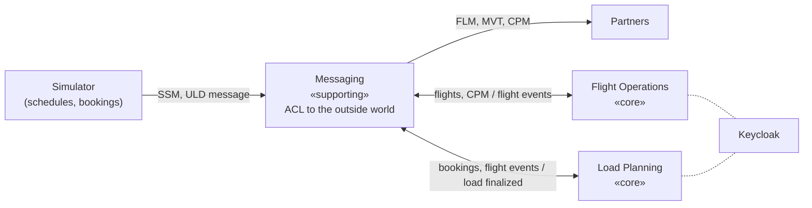

# Air Freight Operations

Flight and cargo management for an air freight carrier, built with strategic and tactical **Domain-Driven Design** as event-driven microservices.

Flight planners keep the day's flights up to date (delays, actual departure and arrival times). Load planners place the booked containers and pallets (ULDs) on the main deck of a Boeing 747-400F, run the load checks (lateral balance, offloading order) and finalize the load. A flight can only depart once its load is finalized. Partners follow everything through standard IATA messages (FLM, MVT, CPM), and a simulator stands in for the existing schedule and booking systems.

Team project by **Romeo Weyns** and **Jonas Friedhoff** for the Software Architecture course at Karel de Grote University of Applied Sciences (2026–27). Code and documentation are in English; the user interface is in Dutch, as the requirements specified.

## Architecture



- **Three bounded contexts, three deployment units**, each a Spring Boot service with its own PostgreSQL database. They share no code and no database; they only talk through events over RabbitMQ.
- **Messaging** is the anti-corruption layer: it turns incoming SSM and ULD messages into clean internal events, routes events between the two core contexts, and writes the outgoing IATA telegrams.
- **Hexagonal layers** in every service (`api` → `application` → `domain` ← `infrastructure`). The domain has no Spring or JPA dependency; ArchUnit + jMolecules tests fail the build if a layer or DDD rule is broken (aggregates reference each other only by ID, entities have an identity, value objects don't reference entities).
- **Rich domain model**: aggregates such as `Flight` and `FlightCargo` enforce their invariants themselves (delay limits, the loading period, ATD only after the CPM, hard checks before finalizing).
- **Reliable messaging**: a transactional outbox with publisher confirms, an inbox for idempotent processing, ordered delivery with a single active consumer, versioned JSON events, retries and dead letter queues.
- **Security**: Keycloak with OAuth2/JWT, a role per context checked server-side, single sign-on across the two frontends.
- **Policy values** (tolerances, loading period, lateral balance limit, retention) are external configuration, changeable without a release.

The full analysis (subdomains, ubiquitous language, context map, aggregates, invariants and the trade-off against a modular monolith) is in [`docs/analysis.md`](docs/analysis.md).

## Tech stack

| Area | Tools |
| --- | --- |
| Backend | Java 25, Spring Boot 4.1, Spring Data JPA, Spring AMQP, Spring Security (resource server), Lombok, JSpecify |
| Infrastructure | PostgreSQL, RabbitMQ, Keycloak, Docker Compose |
| Frontend | TypeScript, Vite, keycloak-js (client-side rendering against the REST APIs) |
| Testing | JUnit 5, AssertJ, Cucumber (Gherkin acceptance criteria), MockMvc, Awaitility, contract tests, ArchUnit + jMolecules, PIT mutation testing, JaCoCo, `node --test` for the page logic |
| Quality | OWASP dependency check, CI pipeline per service with its own database and broker |

## Tests

- Every user story's acceptance criteria are Gherkin scenarios, tagged with the level they are tested at: `@unit` (pure domain, no Spring or mocks), `@integration` (one service from the REST API or queue to a real PostgreSQL and RabbitMQ), `@e2e` and `@ui` (checked by hand, results in [`docs/e2e-hand-checks.md`](docs/e2e-hand-checks.md)).
- Contract tests: one example message per event in [`contracts/`](contracts/), tested by both the publisher and the consumer.
- Line coverage on 4 November 2026: 93 % (Flight Operations), 97 % (Load Planning), 97 % (Messaging), 98 % (simulator). PIT checks that the unit tests actually catch bugs in the domain.

## Documentation

- [`docs/analysis.md`](docs/analysis.md): the domain analysis, context map and tactical design
- [`docs/architecture-overview.md`](docs/architecture-overview.md): where the code lives, the layers and what `DddArchTest` enforces
- [`docs/messaging.md`](docs/messaging.md): outbox, inbox, ordering, dead letter queues, adding an event and recovering a message
- [`docs/errors-and-logging.md`](docs/errors-and-logging.md): the API's error responses and the log levels
- [`docs/persistence.md`](docs/persistence.md): domain and JPA, optimistic locking, transactions and schema changes
- [`docs/security-and-tokens.md`](docs/security-and-tokens.md): Keycloak, roles and tokens
- [`docs/policy-values.md`](docs/policy-values.md): changing the policy values without a release
- [`docs/cucumber-acceptance-tests.md`](docs/cucumber-acceptance-tests.md), [`docs/contract-tests.md`](docs/contract-tests.md), [`docs/frontend-tests.md`](docs/frontend-tests.md), [`docs/mutation-testing-pit.md`](docs/mutation-testing-pit.md), [`docs/e2e-hand-checks.md`](docs/e2e-hand-checks.md): the tests
- [`docs/ci-pipeline.md`](docs/ci-pipeline.md): the CI pipeline
- Design proposals for future extensions (not implemented): [knock-on delay prediction](docs/ideas/knock-on-delay.md) (Jonas Friedhoff) and [autoload](docs/ideas/autoload.md) (Romeo Weyns)

Commit messages refer to the user stories by number (`#12`). Those were issues on the original GitLab board, not issues in this repository.

## Running it locally

Requires JDK 25, Docker, and Node.js with npm.

```bash
cp .env.example .env      # choose a value for every line (Keycloak client secrets and test user passwords)
docker compose up -d      # PostgreSQL 5443, RabbitMQ 5672/15672, Keycloak 8180, MySQL 3307, partner service 8000
./gradlew build           # compiles and tests all modules, also builds the frontends
```

The tests start JPA and need the database, so run `docker compose up -d` first. Docker Compose refuses to start without `.env` and says which value is missing. The usernames and passwords in `docker-compose.yml` and the `application.properties` files are for local development only.

| Module | Start | Port |
| --- | --- | --- |
| Flight Operations | `./gradlew :flight-operations:flight-operations-service:bootRun` | 8080 |
| Load Planning | `./gradlew :load-planning:load-planning-service:bootRun` | 8081 |
| Messaging | `./gradlew :messaging:messaging-service:bootRun` | none (no REST API, only RabbitMQ) |
| Simulator (not in production) | `./gradlew :simulator:simulator-service:bootRun` | 8090 |

Test one module: `./gradlew :flight-operations:flight-operations-service:test`. One test: add `--tests "be.kdg.airfreight.flightoperations.DddArchTest"`.

Frontend during development: `npm run dev` in `flight-operations/flight-operations-frontend` or `load-planning/load-planning-frontend`. Vite runs on 5173 and proxies `/api` to the service. Run only one frontend at a time: both use port 5173, and another port is not a valid redirect in the realm (`npm run dev -- --strictPort` fails clearly instead of moving to 5174).

Every context has its own database (`flight_operations`, `load_planning`, `messaging`) and its own test database (`*_test`) on the same PostgreSQL, created by `init-scripts/sql/init.sql` on the first start. The data survives a restart (`ddl-auto=update`); the test databases are recreated on every run.

RabbitMQ: http://localhost:15672 (`user` / `password`). Keycloak: http://localhost:8180 (`admin` / `admin`).

### Logging in

On its first start Keycloak imports the realm `air-freight` from `keycloak/air-freight-realm.json`: the roles `flight-planner` and `load-planner`, the clients of the frontends and the services, and two test users. The realm file only holds placeholders (`${LOAD_PLANNER_PASSWORD}`, …); Docker Compose passes the values from `.env` to Keycloak, which fills them in on import. If the realm file changes later, delete the realm in the Keycloak console and restart Keycloak; an existing realm is not imported again.

| User | Password | Role |
| --- | --- | --- |
| `flight_planner` | `FLIGHT_PLANNER_PASSWORD` from `.env` | flight planner |
| `load_planner` | `LOAD_PLANNER_PASSWORD` from `.env` | load planner |

Keycloak decides who is a planner. A new colleague with the role `flight-planner` or `load-planner` can start right away, without a restart: the service registers a planner on their first change, with the id of the Keycloak account and the name from the token.

The APIs answer 401 without a token and 403 with the wrong role. Two `.http` files log in and try an API: `flight-operations/flight-operations-service/http/flight_api.http` (as `flight_planner`) and `load-planning/load-planning-service/http/cargo_api.http` (as `load_planner` and as `flight_planner`). They read the client secret and the passwords from a file `http-client.private.env.json` next to each `http-client.env.json` (gitignored), with the values from your `.env`:

```json
{
  "dev": {
    "client-secret": "FLIGHT_OPERATIONS_SERVICE_CLIENT_SECRET",
    "password": "FLIGHT_PLANNER_PASSWORD"
  }
}
```

For Load Planning, which logs in as both planners and also shows that a token for another service is refused (the audience):

```json
{
  "dev": {
    "client-secret": "LOAD_PLANNING_SERVICE_CLIENT_SECRET",
    "flight-operations-client-secret": "FLIGHT_OPERATIONS_SERVICE_CLIENT_SECRET",
    "load-planner-password": "LOAD_PLANNER_PASSWORD",
    "flight-planner-password": "FLIGHT_PLANNER_PASSWORD"
  }
}
```

### Pages

| Context | Page | Address after `bootRun` |
| --- | --- | --- |
| Flight Operations | Start page: the entry point after logging in, with today's flights (UTC) | http://localhost:8080/ |
| Flight Operations | Flight details | http://localhost:8080/html/flight-details.html?flightId=… |
| Flight Operations | Gantt chart: the flights of one day on a timeline | http://localhost:8080/html/gantt-chart.html |
| Load Planning | Start page | http://localhost:8081/ |
| Load Planning | Flights to load | http://localhost:8081/html/flights-to-load.html |
| Load Planning | Cargo page with the floor plan | through a flight in the list of flights to load |

After logging in on one context, the other opens without asking for a password again: both frontends use the same realm. The address of the other context comes from a Vite variable, `VITE_LOAD_PLANNING_URL` (default `http://localhost:8081`) and `VITE_FLIGHT_OPERATIONS_URL` (default `http://localhost:8080`).

### Messages between the services

| Service | Publishes on | Reads from |
| --- | --- | --- |
| Flight Operations | `flight-operations.events` | `flight-operations.messaging-events` |
| Load Planning | `load-planning.events` | `load-planning.messaging-events` |
| Messaging | `messaging.events` (for the other services), `partner-exchange` (FLM, MVT, CPM) | `messaging.schedule`, `messaging.bookings`, `messaging.flights`, `messaging.loads` |

- The partner messages go to `partner-exchange`. A partner service mock (`docker-compose.override.yml`, starts with `docker compose up -d`) reads them through its own queue `partner-inbox` and shows them on http://localhost:8000. Messaging also puts them in the queue `partners.all`, so they can be inspected in RabbitMQ.
- A message a service cannot process ends up in its dead letter queue: `flight-operations.dlq`, `load-planning.dlq` or `messaging.dlq`.
- Every service first stores its outgoing events in the table `outbox_events` and sends them afterwards. If RabbitMQ is down, they follow as soon as it is back.
- Never start two instances of the same service at once: the order of the messages depends on one reader per queue.
- `messaging/messaging-service/http/messaging.http` sends messages straight to an exchange, to try the Messaging service on its own.
- The simulator stands in for the two source systems: `POST /api/flight-schedules` sends one SSM per record to `network-planning.messages`, `POST /api/cargo-bookings` one ULD message per record to `cargo-booking.messages`. Examples are in `simulator/simulator-service/http/simulator.http`. Start Messaging first: it creates the queues. With `--spring.profiles.active=production` the endpoints don't exist (404).

### Known vulnerabilities in dependencies

Every service applies the OWASP dependency-check plugin. It compares the dependencies with the National Vulnerability Database (NVD) and fails on a known vulnerability with a CVSS score of 7 or higher:

```bash
export NVD_API_KEY=<your key>     # https://nvd.nist.gov/developers/request-an-api-key
./gradlew :load-planning:load-planning-service:dependencyCheckAnalyze   # report in the service's build/reports
```

The first run downloads the whole database; without a key that takes hours. The check is not part of `./gradlew build`, so the build stays fast and works offline. Two findings concern another product with a similar name and are suppressed in `dependency-check-suppressions.xml`, each for one CVE on one library, with the reason.
