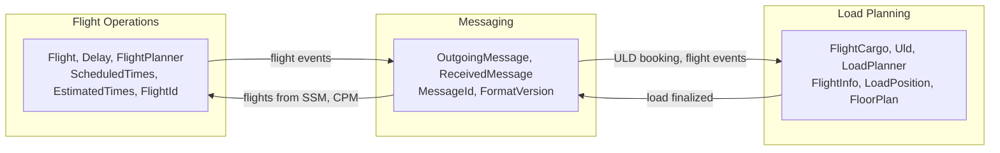
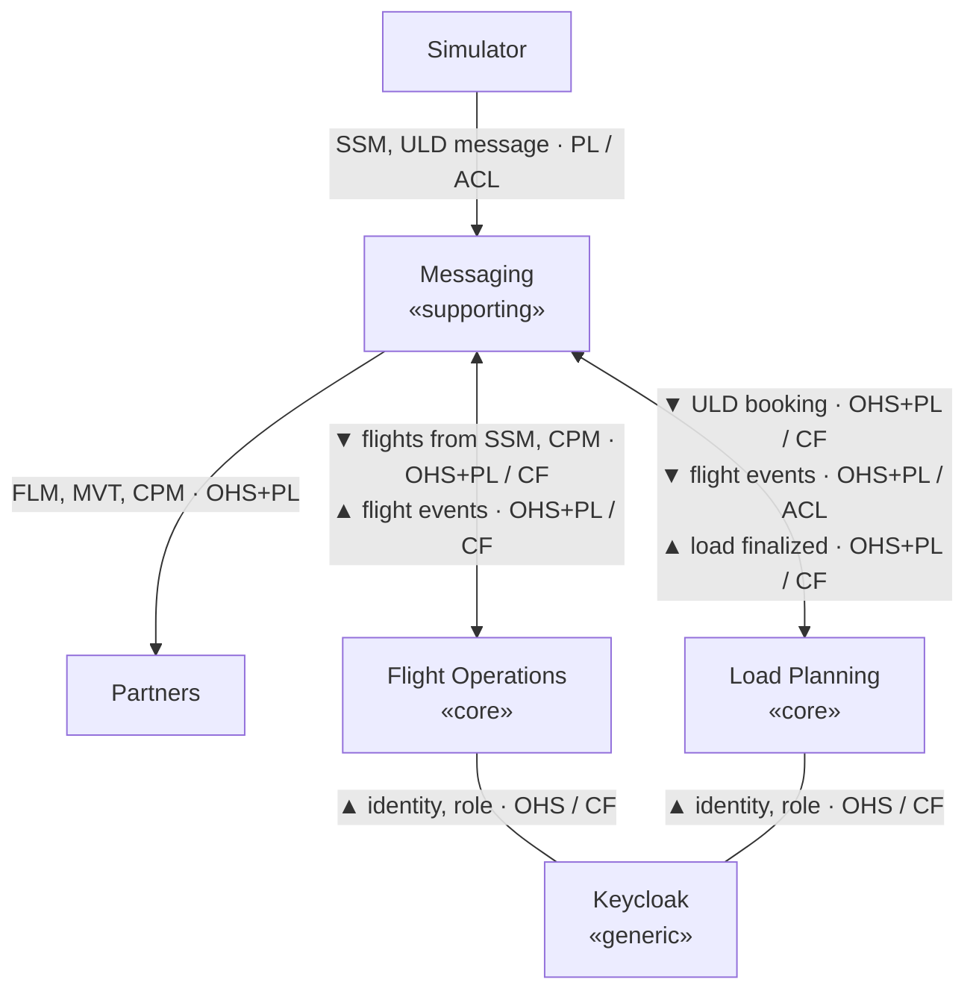
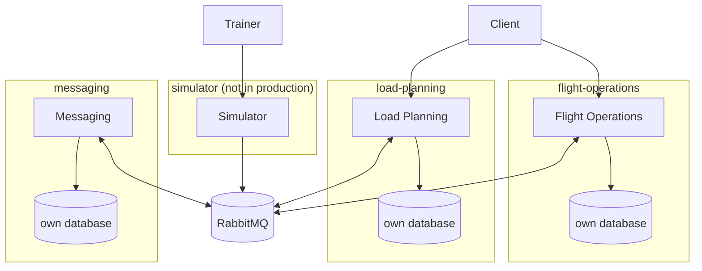
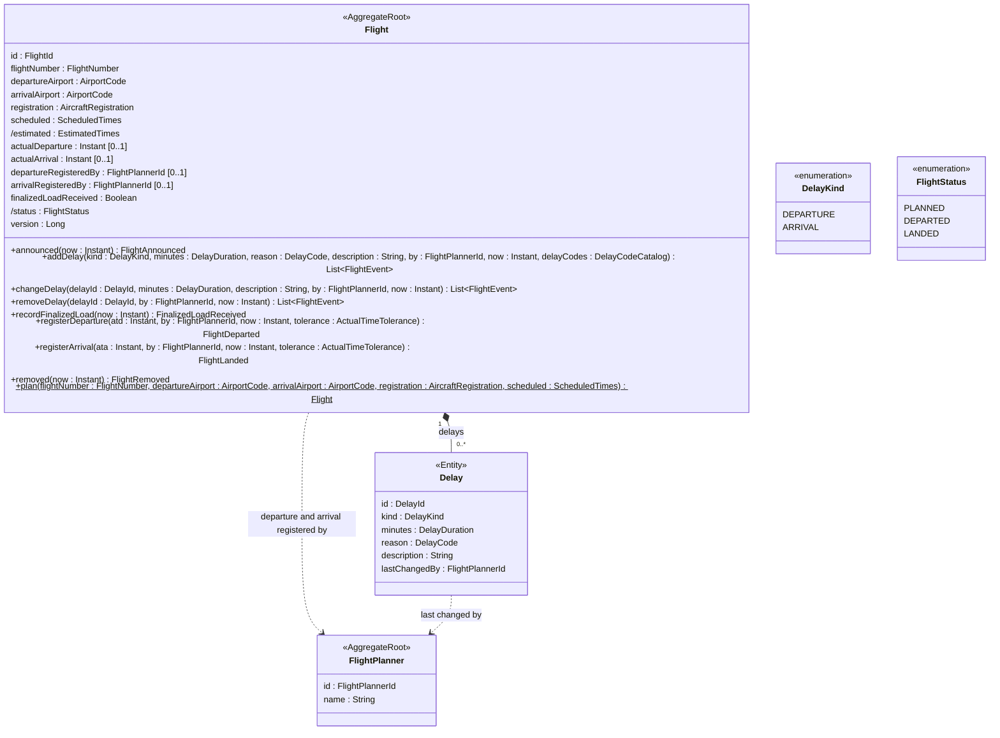
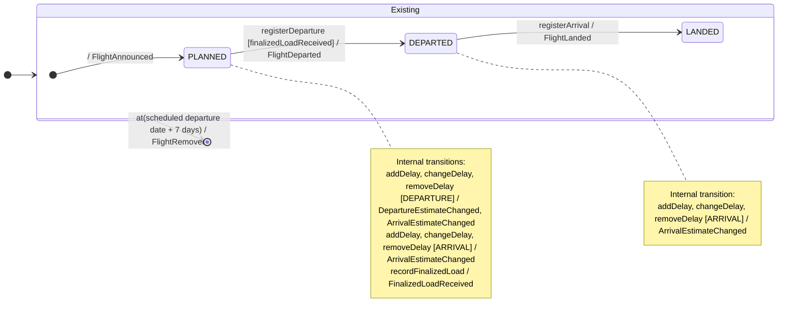
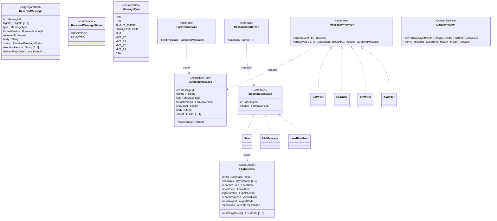

# Air Freight: domain analysis

An airline carries cargo on a fixed flight schedule. Flight planners keep the flights up to date on the day itself; load planners plan the cargo onto the aircraft. Partners follow everything through IATA messages.

This is the strategic and tactical DDD analysis behind the code: three bounded contexts of our own, each its own deployment unit, integrated through messages over RabbitMQ.

**Contents**

- [1. Domain](#1-domain)
- [2. Subdomains](#2-subdomains)
- [3. Bounded contexts](#3-bounded-contexts)
- [4. Ubiquitous language](#4-ubiquitous-language)
- [5. Context map](#5-context-map)
- [6. Deployment](#6-deployment)
- [7. Tactical design](#7-tactical-design)
  - [7.1. Flight Operations](#71-flight-operations)
  - [7.2. Load Planning](#72-load-planning)
  - [7.3. Messaging](#73-messaging)
- [8. Test strategy](#8-test-strategy)
- [9. Design for change](#9-design-for-change)

## 1. Domain

- **Flight planner:** enters delays with a delay reason and registers the ATD and ATA. Never changes the scheduled times.
- **Load planner:** gives ULDs a load position, checks the load with load checks and finalizes the load.
- **Who did what:** every change records the planner who made it.
- **Where they meet:**
  - A flight can only depart once its load is finalized.
  - A departure delay moves the end of the loading period as long as that period is still open; a period that has passed never reopens. "Open" is judged at the moment the delay was entered in Flight Operations (the event's `occurredOn`), not when Load Planning reads the message.
- **Partners:** receive FLM, MVT and CPM messages, even though no partner is connected yet.
- **Existing systems:** deliver the flight schedule (SSM) and the bookings (ULD messages). A simulator stands in for them.

## 2. Subdomains

| Subdomain | Type | Rationale |
| --- | --- | --- |
| Load Planning | Core | The most complex rules (offloading routes, lateral balance, loading period) and the most announced changes. Gets the most design attention. |
| Flight Operations | Core | A flight schedule customers can rely on, with early insight into delays, sets us apart |
| Messaging | Supporting | Specialist knowledge (IATA telegrams, date derivation, duplicates, guaranteed delivery), but no competitive advantage |
| Network planning | Generic | Existing system, delivers SSMs |
| Cargo booking | Generic | Existing system, delivers ULD messages |
| Identity & Access | Generic | Keycloak |
| IATA reference data | Generic | Airport and delay codes |

**Not a subdomain:**

- The simulator: it replaces the existing systems.
- The database and RabbitMQ: technology.
- The retention period and logging: rules inside the contexts.

## 3. Bounded contexts

Every core and supporting subdomain is one bounded context. The generic subdomains are external contexts: the schedule and booking sources (simulated), Keycloak and the IATA lists.

The same in every context:

- **Flight:** identified by flight number, scheduled departure date and departure airport.
- **Airport:** always the IATA code.
- **Time:** UTC; screens show and ask for Brussels time and say so. A local time that does not exist (the switch to summer time) is refused; for an ambiguous local time (the switch to winter time) the planner chooses whether summer or winter time is meant.
- **Date of a flight:** the scheduled departure date is a UTC date and never changes, not even when the ETD falls after midnight. The same date is the day in every telegram about the flight and decides on which day the flight appears in the overviews; a new day starts at 00:00 UTC.

## 4. Ubiquitous language

| Term | Flight Operations | Load Planning | Messaging |
| --- | --- | --- | --- |
| Flight | Aggregate: times and state are managed here | Read-only copy: airports, times, departed or not | Only the identity and the values for a message |
| Flight planner | Entity: the planner who enters a delay, ATD or ATA | – | – |
| Load planner | – | Entity: the planner who assigns a load position or finalizes the load | – |
| Flight series | – | – | One route from an SSM: one flight number over a period. Messaging turns it into one flight per matching day |
| Delay | Minutes, delay reason, description; before departure or arrival | – | – |
| ETD / ETA | Calculated from the scheduled times + delays | ETD − 20 min = end of the loading period | Value in MVT-ED / MVT-EA |
| ATD / ATA | Registered, fixed afterwards | Only "departed": the load is fixed | Value in MVT-AD / MVT-AA |
| Finalized | "CPM received": a condition for the ATD | Load passed the hard checks, can no longer change | Reason for a CPM |
| ULD | – | Container or pallet: code, weight, destination | Line in a CPM or ULD message |
| Booked | – | ULD expected on the flight, without a load position yet | – |
| Load position | – | Place on the deck: A1, A2, B1, rows C–U left and right, X | Line in a CPM |
| Floor plan | – | The load positions and the cargo door of one aircraft type | – |
| Aircraft type | – | Decides which floor plan applies | – |
| Destination | – | Airport a ULD goes to; ULDs for the arrival airport must come out without moving other cargo. Can differ from the arrival airport: such a ULD stays on board and is only an obstacle when offloading. Every flight is handled on its own; multi-leg flights are out of scope | Field in CPM and ULD message |
| Load | – | The ULDs with a load position | – |
| Loading period | – | From STD − 12 h (inclusive) to ETD − 20 min (exclusive), with the ETD of that moment: a delay can extend or close an open period, but a period that has passed stays closed. Whether it has passed is judged at the moment the delay was entered in Flight Operations (the event's `occurredOn`) | – |
| Load check | – | Hard (lateral balance, offloading) or soft (not all cargo loaded) | – |
| Telegram | – | – | MVT in IATA text: only the day of the month of the scheduled departure date and a time |
| Duplicate | – | – | A message received again: recognized, not processed again |

## 5. Context map

An arrow, or a ▼ / ▲ in a label, points from upstream to downstream. Each label shows the message · the pattern upstream / downstream.

| Pattern | Where |
| --- | --- |
| Published Language | SSM, ULD message and MVT (fixed format); FLM and CPM (content fixed, JSON structure designed by us); the internal events (our design) |
| Anti-Corruption Layer | Messaging translates SSM and ULD messages into clean internal events: one SSM becomes one event per flight. Load Planning builds its own flight copy (`FlightInfo`) from the flight events that Messaging passes on. |
| Open Host Service | Every context publishes one set of events for all consumers |
| Conformist | Flight Operations and Load Planning take the events of Messaging as they are; Messaging does the same with theirs. Flight Operations and Load Planning conform to Keycloak: the identity of a `FlightPlanner` or `LoadPlanner` is that of the Keycloak account. All contexts conform to the IATA lists. |

- **Everything through Messaging:** Flight Operations and Load Planning exchange no events directly. Messaging passes the flight events of Flight Operations on to Load Planning, including the CPM that allows a departure.
- **No Shared Kernel:** no shared domain code. Even the outbox exists separately in every context; a shared technical library for it would be fine if that code grows.
- **Shared example messages in the tests:** the services share no code, but they do share one example message per event in `contracts/`. The service that publishes the event and the service that reads it both test against the same file, so a field that changes on one side shows up in the tests. It is test data for the Published Language, not a Shared Kernel.
- **Internal events instead of telegrams:** the internal events carry full UTC times, so the 12-hour limit of the telegram format plays no role internally.
- **Departure after finalizing:** Flight Operations refuses an ATD, with an explanation, until the CPM has been processed. The flight planner always gets an answer right away: accepted, or refused with the reason. An ATD is never accepted first and silently undone later.
- **Reliability:** every context stores a change and its event together (outbox) and publishes the events in order as soon as RabbitMQ is reachable. A change therefore succeeds even when RabbitMQ is down. Messaging keeps the IDs of processed messages (inbox) and processes each message once. Flight Operations and Load Planning have no inbox: every event states what the state is now, so a duplicate changes nothing (natural idempotency). Flight events carry no version and contain only what changed; the receiver processes them in order of arrival, with one queue and one reader (single active consumer).

## 6. Deployment

- **One unit per bounded context**, as the project required. No shared database, no shared domain code; messages are the only way between them.
- **Policy values** have one owner and can be changed without a release:
  - Flight Operations: tolerance 5 min, retention 7 days.
  - Load Planning: loading period 12 h / 20 min, lateral balance 10 %.
  - They live in the external configuration of the unit: environment variables or an `application.properties` next to the JAR, read with `@ConfigurationProperties`. Operations changes them there and restarts the unit; no new build or release is needed. There is no screen for it, because operations is not a role in Keycloak.
- **Roles:** every unit checks the role server-side on every change and records the planner who makes it: Flight Operations only knows flight planners, Load Planning only load planners. An API call without a valid token gets 401, not a redirect to Keycloak; a call with the wrong role gets 403. A user with no role or with both roles gets no access.
- **One entry point, each context its own screens:** the start page of Flight Operations is the entry point after logging in. Every unit shows and changes only its own data: a page only calls the API of its own unit, with a token for that unit. A planner moves from one unit to the other through a link; Keycloak recognizes them, so they log in only once. A page of the other context finds the flight through its identity (flight number, scheduled departure date, departure airport), never through an internal id. One shared frontend for both contexts would erase the boundary between the contexts in the screens and would need a second audience and CORS.
- **Retention:** on the scheduled departure date + 7 days at 00:00 UTC, Flight Operations deletes the flight and reports `FlightRemoved`; Load Planning and Messaging then delete their data about that flight, including bookings without a load position. The partners get no message about it.
- **Error handling:** synchronous API calls answer according to REST, with a Problem Details body (RFC 9457) with our own error code and an explanation that the screen shows:
  - 400 for input that is invalid on its own: outside 1 min–12 h, an unknown delay reason, a position outside the floor plan;
  - 401 and 403 for authentication and role;
  - 404 for a flight that does not exist;
  - 409 for an action that does not fit the current state: the wrong state, outside the loading period, the CPM not yet received, an ATD or ATA too late, or a concurrent change (optimistic locking);
  - 503 when the unit's own database is unreachable, without internal details in the answer;
  - 500 for another database error (`database-error`) or an unexpected error (`unexpected-error`), also without internal details. The error itself, with the request and the stack trace, is logged at level `error`.
- **Technical errors in the log:** every unit logs an error of its database or of RabbitMQ at level `error`, with the cause, where it notices it: in the answer to an API call, in the relay of an outbox, or after the last attempt to process an incoming message. The relays wait for RabbitMQ's acknowledgement (publisher confirms): a message RabbitMQ does not accept stays in the outbox and is retried. A refused or invalid message is an input error and gets `warn`, a duplicate `info`.
- **A message that fails while the database is down:** the unit retries it three more times and then puts it on its dead letter queue, with an `error` in the log. The message is not lost, but the messages after it are processed. The alternative, putting it back on the queue until the database returns, keeps the order and recovers by itself, but blocks the whole queue for as long as the outage lasts. We chose not to block the queue; a missed message is resent by hand.

**Modular monolith or separate units?** The project required one deployment unit per bounded context. For this project a modular monolith would have been the better choice. The scale is limited: one airline and a handful of planners. On top of that, the contexts are tightly coupled: the ETD decides the end of the loading period, and the CPM decides whether a flight may depart. In one process those are plain calls within one transaction. With separate units they become messages, with an outbox, duplicates, eventual consistency and a race between finalizing and departing. One team with one deployment also tests and debugs more easily, and the context boundaries can just as well be enforced as modules.

The split does bring something:

- **Each context at its own pace:** Load Planning changes most often, with new load checks and aircraft types. Those changes roll out without touching Flight Operations and Messaging.
- **Targeted scaling:** every unit gets the resources it needs. If Load Planning gets heavier, for example through an autoload that searches for the best layout, only that unit scales while the others stay light.
- **Isolation:** a failure or heavy load in one context does not affect the others. If Messaging or RabbitMQ goes down, the planners keep working and the messages follow later.
- **Own technology:** a context can use a library the others don't need, such as an optimization library.
- **Learning:** working with explicit contracts, duplicate and late messages, and eventual consistency.

Much of that gain is potential and only becomes large as the system grows. A modular monolith with strictly guarded boundaries can split off a context later, and only pays the price of messages and eventual consistency when it is needed.

## 7. Tactical design

### 7.1. Flight Operations

| Building block | Elements |
| --- | --- |
| Actor | Flight planner, Messaging (flights from an SSM, CPM), clock (retention) |
| Aggregate root | `Flight`; `FlightPlanner`: an entity with its own life cycle, independent of the flights, so the root of its own aggregate |
| Entity | `Delay`: changed and removed on its own, so it has its own identity |
| Value object | `FlightId` (technical UUID), `FlightNumber`, `FlightPlannerId`, `ScheduledTimes`, `EstimatedTimes`, `DelayId`, `DelayDuration`, `DelayCode`, `DelayReason` (a line from the IATA list: code and meaning), `AirportCode`, `AircraftRegistration`; the policy values `ActualTimeTolerance` and `RetentionPeriod`; enumerations `DelayKind`, `FlightStatus` |
| Factory | `Flight.plan(...)`: creates one valid flight with a new `FlightId` from a `FlightScheduled` event of Messaging |
| Domain service | `DelayCodeCatalog` and `AirportCatalog`: the IATA lists of delay reasons and airports. `addDelay` receives the catalog and refuses an unknown delay reason itself |
| Domain event | `FlightAnnounced`, `DepartureEstimateChanged`, `ArrivalEstimateChanged`, `FinalizedLoadReceived`, `FlightDeparted`, `FlightLanded`, `FlightRemoved` |
| Repository | `FlightRepository`: by id, by identity (flight number, scheduled departure date, departure airport), the flights of one day and the flights up to a date (retention). `FlightPlannerRepository` |

The methods receive the time `now` instead of reading the clock themselves, and the policy value where needed. A method that changes the flight returns the event or events it produces; a departure delay returns two.

Invariants on `Flight`:

1. ETD = STD + departure delays; ETA = STA + all delays
2. every delay is a `DelayDuration` (1 min–12 h), and all delays of a flight together are at most 12 h; a departure delay only while *planned*, an arrival delay until *landed*
3. ATD and ATA ≤ now and ≤ estimated + 5 min; fixed afterwards, so a second registration is refused and produces no second MVT-AD or MVT-AA
4. ATD only after the CPM: the `CpmCreated` event of Messaging calls `recordFinalizedLoad()`; ATA only after the ATD, and strictly later than the ATD
5. every delay, ATD and ATA records the flight planner; when a delay is removed, the planner is in the event

`Flight` and `Delay` refer to the planner by their `FlightPlannerId`, never by an object reference: a planner exists independently of a flight and remains when the flight disappears after 7 days. Keycloak creates the accounts and a `FlightPlanner` takes over the identity of its account; the service registers a planner on their first change, with the name from the token, in a separate transaction before the change itself.

Concurrent changes are caught with optimistic locking: a conflict gives 409. The version stays inside Flight Operations; flight events do not carry it (§5).

Flight Operations only creates a flight if it does not exist yet; an existing one is skipped and logged, and never overwritten, not even if the SSM has other times or another registration. A unique key on flight number, scheduled departure date and departure airport keeps that true when two announcements are processed at the same time. Messaging only writes the FLM on `FlightAnnounced`, so an existing flight never gets a second FLM.

The state `Existing` covers the three states: the time event `at(...)` deletes the flight whether it is planned, departed or landed. Delays do not change the state and are therefore internal transitions. A departure delay also moves the ETA and therefore reports both events.

### 7.2. Load Planning

```mermaid
classDiagram
    class FlightCargo {
        <<AggregateRoot>>
        id : FlightCargoId
        flightId : FlightId
        loadingClosesAt : Instant
        finalized : Boolean
        finalizedBy : LoadPlannerId [0..1]
        version : Long
        +create(flightId : FlightId, flightInfo : FlightInfo, policy : LoadingPolicy) FlightCargo$
        +updateFlightInfo(newer : FlightInfo)
        +changeEstimatedDeparture(etd : Instant, changedAt : Instant, policy : LoadingPolicy)
        +hasBooked(code : UldCode) Boolean
        +book(code : UldCode, weight : Weight, destination : AirportCode, now : Instant) UldBooked
        +assign(code : UldCode, position : LoadPosition, by : LoadPlannerId, now : Instant, floorPlan : FloorPlan, policy : LoadingPolicy) LoadPositionAssigned
        +clear(code : UldCode, by : LoadPlannerId, now : Instant, policy : LoadingPolicy) LoadPositionCleared
        +checkLoad(checks : List~LoadCheck~, floorPlan : FloorPlan, now : Instant, policy : LoadingPolicy) LoadCheckReport
        +finalizeLoad(by : LoadPlannerId, now : Instant, checks : List~LoadCheck~, floorPlan : FloorPlan, policy : LoadingPolicy) LoadFinalized
        +loadCanChange(now : Instant, policy : LoadingPolicy) Boolean
        +loadingPeriod(policy : LoadingPolicy) LoadingPeriod
    }
    class FlightInfo {
        <<ValueObject>>
        arrivalAirport : AirportCode
        aircraftType : AircraftType
        std : Instant
        sta : Instant
        etd : Instant
        eta : Instant
        departed : Boolean
    }
    class Uld {
        <<Entity>>
        code : UldCode
        weight : Weight
        destination : AirportCode
        position : LoadPosition [0..1]
        positionChangedBy : LoadPlannerId [0..1]
    }
    class LoadPlanner {
        <<AggregateRoot>>
        id : LoadPlannerId
        name : String
    }
    class LoadPosition {
        <<ValueObject>>
        name : String
        side : Side [0..1]
    }
    class Side {
        <<enumeration>>
        LEFT
        RIGHT
    }
    class AircraftType {
        <<ValueObject>>
        code : String
    }
    class FloorPlan {
        <<ValueObject>>
        aircraftType : AircraftType
        door : LoadPosition
        +contains(position : LoadPosition) Boolean
        +routesToDoor(from : LoadPosition) List~Route~
    }
    class FloorPlanCatalog {
        <<interface>>
        +floorPlanFor(type : AircraftType) FloorPlan
    }
    class LoadCheck {
        <<interface>>
        +name() String
        +severity() CheckSeverity
        +check(cargo : FlightCargo, floorPlan : FloorPlan) LoadCheckResult
    }
    class CheckSeverity {
        <<enumeration>>
        HARD
        SOFT
    }
    class LoadCheckReport {
        <<ValueObject>>
        results : LoadCheckResult [0..*]
        +hardChecksPassed() Boolean
    }
    class LoadCheckResult {
        <<ValueObject>>
        checkName : String
        passed : Boolean
        reason : String [0..1]
        severity : CheckSeverity
        details : LoadCheckDetails [0..1]
    }
    class LoadCheckDetails {
        <<interface>>
    }
    class OffloadingDetails {
        <<ValueObject>>
        obstructions : Obstruction [0..*]
    }
    class Obstruction {
        <<ValueObject>>
        stuck : LoadedUld
        inTheWay : LoadedUld [1..*]
    }
    class LateralBalanceDetails {
        <<ValueObject>>
        leftKilograms : BigDecimal
        rightKilograms : BigDecimal
        maximumOnTheHeaviestSide : BigDecimal
        heavierSide : Side [0..1]
    }
    class LateralBalanceCheck
    class OffloadingCheck
    class AllCargoLoadedCheck
    FlightCargo "1" *-- "1" FlightInfo : flightInfo
    FlightCargo "1" *-- "0..*" Uld : ulds
    FlightCargo ..> LoadPlanner : finalized by
    Uld ..> LoadPlanner : position changed by
    FlightCargo ..> FloorPlan : «use»
    FlightCargo ..> LoadCheck : «use»
    FlightCargo ..> LoadCheckReport : «create»
    FloorPlanCatalog ..> FloorPlan : «create»
    LoadCheck <|.. LateralBalanceCheck
    LoadCheck <|.. OffloadingCheck
    LoadCheck <|.. AllCargoLoadedCheck
    LoadCheckDetails <|.. OffloadingDetails
    LoadCheckDetails <|.. LateralBalanceDetails
    OffloadingDetails "1" *-- "0..*" Obstruction
```

Besides their sentence, the offloading check and the lateral balance also return what they found as data (`LoadCheckDetails`): which ULD cannot be offloaded and which ULDs are in the way, and the weight per side. The cargo page shows that on the floor plan. Both checks build their sentence from the same data, so the two cannot differ. A check without such data, like "not all cargo loaded", has none. The floor plan knows its cargo door (RL on the 747-400F).

`side` is empty for A1, A2, B1 and X; that is why they don't count towards the lateral balance.

The first version only knows the aircraft type Boeing 747-400F: every `FlightInfo` gets that type and `FloorPlanCatalog` delivers one floor plan with 34 load positions: A1, A2, B1, an L and an R position in rows C, D, E, F, G, H, J, K, L, M, P, R, S, T and U, and X. To offload A1, A2 and B1 must be free besides CL and CR; to offload A2, B1 must be free.

`FlightCargo` has a technical `FlightCargoId` (UUID); in Load Planning `FlightId` is the identity of the flight itself: flight number, scheduled departure date and departure airport. `FlightInfo` has no version: the flight events arrive in order (§5) and every event sets a value (ETD, ETA, departed), so a duplicate event changes nothing. A new ETD goes through `changeEstimatedDeparture`, which also moves the end of the loading period (`loadingClosesAt`) as long as the period is open. It judges "open" on `changedAt`, the event's `occurredOn`: a delay entered within the period that arrives late (RabbitMQ, Messaging or Load Planning was down) still extends the period. `departed` stays true after landing, so a landed flight also counts as departed.

| Building block | Elements |
| --- | --- |
| Actor | Load planner, Messaging (ULD booking, flight events) |
| Aggregate root | `FlightCargo`: one per flight, all rules are about all ULDs together. `LoadPlanner`: an entity with its own life cycle, independent of the flights, so the root of its own aggregate |
| Entity | `Uld`: identified by its code, its position changes |
| Value object | `FlightCargoId`, `FlightId`, `FlightNumber`, `FlightInfo` (copy, replaced in full every time), `LoadPlannerId`, `AircraftType`, `UldCode`, `Weight`, `WeightUnit`, `AirportCode`, `LoadPosition`, `FloorPlan`, `Route`, `LoadingPeriod`, `LoadCheckResult`, `LoadCheckReport`, `LoadedUld` (one ULD on its load position: a line of the CPM, and what the offloading check reports), `OffloadingDetails`, `Obstruction`, `LateralBalanceDetails`; the policy values `LoadingPolicy` (12 h / 20 min) and `LateralBalanceLimit` (10 %); enumerations `Side`, `CheckSeverity` |
| Factory | `FlightCargo.create(flightId, flightInfo, policy)`: creates the empty cargo as soon as a flight is announced. `FlightInfo` has no factory: every flight event creates a new, complete `FlightInfo`, which `updateFlightInfo` puts in place of the previous one |
| Domain service | `LoadCheck`: lateral balance, offloading, not all cargo loaded; `FloorPlanCatalog`: gives the floor plan per aircraft type |
| Domain event | `UldBooked`, `LoadPositionAssigned`, `LoadPositionCleared`, `LoadFinalized` |
| Repository | `FlightCargoRepository`, `LoadPlannerRepository` |

`book` refuses a ULD code that is already booked; the application service first asks `hasBooked` and ignores and logs a duplicate booking, as the requirements ask. `finalizeLoad` runs the checks itself and refuses if a hard check fails.

Invariants on `FlightCargo`:

1. a ULD code at most once per flight
2. one ULD per load position and vice versa; only positions from the floor plan
3. booking is possible from the announcement of the flight (bookings arrive up to two weeks ahead) until departure, also after finalizing: such a ULD stays behind without a load position and is not in the CPM; changing load positions and finalizing only within the loading period, before finalizing and before departure
4. finalizing only if all hard checks pass at that moment, and only once
5. every assigned or cleared load position and every finalization records the load planner
6. the loading period `[STD − 12 h, ETD − 20 min)` follows the current `FlightInfo` as long as it is open: a delay moves the end and can close an open period. A period that has passed stays closed; "passed" is judged at the moment the delay was entered in Flight Operations (`occurredOn`), not when Load Planning reads the message. Otherwise a delay entered in time that arrives late (RabbitMQ, Messaging or Load Planning was down for a moment) would close the period for good: the load could then no longer be finalized and the flight could never depart. That Load Planning briefly shows the period as closed until the event arrives is the smaller problem.
7. an empty load passes all hard checks, so a flight without cargo can depart. The lateral balance converts all weights to kg and compares heaviest side ≤ lightest side × (1 + limit), without rounding; 0 kg against 0 kg therefore passes, without division by zero
8. a failed check names the ULDs concerned in its reason: for offloading every ULD that cannot be offloaded and what is in the way, for not all cargo loaded every ULD without a load position

`FlightCargo` and `Uld` refer to the planner by their `LoadPlannerId`. A booking comes from Messaging and has no planner. Keycloak creates the accounts and a `LoadPlanner` takes over the identity of its account; the service registers a planner on their first change, with the name from the token, in a separate transaction before the change itself.

Concurrent changes are caught with optimistic locking: of two load planners choosing the same position at the same time, one gets a conflict (409).

`LoadPositionAssigned` and `LoadPositionCleared` stay inside Load Planning; only `LoadFinalized` leads to a message to the partners, the CPM. There is no message per change.

### 7.3. Messaging

The readers and the JSON writers live in the infrastructure layer, because JSON is a format and not a rule: `JsonSsmReader`, `JsonUldMessageReader`, `JsonFlightEventReader` and `JsonLoadFinalizedReader` implement `MessageReader`; `FlmWriter` and `CpmWriter` implement `MessageWriter`. The MVT writers (`EdWriter`, `EaWriter`, `AdWriter`, `AaWriter`) live in the domain: the three-line telegram and the day of the month are business rules. `PartnerGateway` is the port to the partners; the infrastructure publishes through RabbitMQ.

Every message carries a format version, and a reader only knows version 1. A message with another version is refused like an invalid message: in Messaging as `REJECTED` in the inbox, in Flight Operations and Load Planning to the dead letter queue, logged every time. That way a new format is never silently read as the old one, and nothing gets lost. The downside: a change an old reader cannot handle requires the readers to be updated together with the publisher, or readers that know both versions first (design for change: a new version is an extra `MessageReader`, the existing one stays unchanged).

| Building block | Elements |
| --- | --- |
| Actor | Simulator (existing sources), Flight Operations and Load Planning (events), partners (receivers) |
| Aggregate root | `OutgoingMessage`: one FLM, MVT or CPM until it is sent. `ReceivedMessage`: one received message with the dates derived from it |
| Value object | `MessageId`, `FlightId` (empty for an SSM, which announces several flights), `FlightSeries`, `SchedulePeriod`, `FlightNumber`, `AirportCode`, `AircraftRegistration`, `FormatVersion`, `UldCode`, `WeightUnit`, `CpmLine`; the received messages `Ssm`, `UldMessage`, `LoadFinalized` and one record per flight event, each an `IncomingMessage`; enumerations `MessageType`, `ReceivedMessageStatus` |
| Domain service | `MessageWriter`, one per outgoing message type (FLM, CPM, MVT-ED, EA, AD, AA); the four MVT writers extend `MvtWriter`, which builds the telegram: a subclass only says which event it writes for and which code, registration, airport and time go in it; `MessageReader`, one per incoming message type (SSM, ULD message, flight event, load finalized); `AirportCatalog`: the IATA airport list, an SSM with an airport not in it is refused; `DateDerivation`: derives the scheduled departure date from the day of the month in a ULD message, and later also the time from a partner telegram |
| Domain event | `FlightScheduled` (one per flight from an SSM, with STD and STA as full UTC times), `UldBookingReceived`, `CpmCreated`. An invalid message produces no event: it is stored as `REJECTED` (the reader or the rule throws an `InvalidMessageException`). Messaging passes the flight events of Flight Operations on to Load Planning |
| Repository | `OutgoingMessageRepository`, `ReceivedMessageRepository`; a duplicate is recognized by its `MessageId`. Port `PartnerGateway` for sending to the partners |

Invariants:

1. every message has a unique ID and a format version; an outgoing message also a creation time, a received message a time of receipt
2. every outgoing message is sent exactly once, also after an interruption
3. a received message is processed once; derived dates are fixed afterwards
4. an invalid message is kept apart (`REJECTED`, with the reason) and logged, never silently lost
5. an SSM produces one `FlightScheduled` per matching day in the period; if the arrival time is at or before the departure time, the STA falls on the next day
6. on `FlightRemoved` all messages with that `flightId` disappear
7. the day in a telegram is always the day of the scheduled departure date, also in an EA or AA whose arrival falls on the next day; the time is the UTC time of the moment itself, even if that falls on another date
8. the content of an MVT is only the three-line telegram; ID, creation time and format version are in the AMQP properties and headers. A message that is sent again keeps its ID, so partners can recognize it
9. the events of Flight Operations and Load Planning are deduplicated too (inbox): the same event twice produces one outgoing message
10. `DateDerivation` picks the nearest date, measured in calendar days, and on a tie the future one; a day that does not exist in that month makes the message invalid (logged as an error). A time becomes the nearest moment within twelve hours, and at exactly twelve hours the later one

In this version Messaging reads no telegrams: Load Planning gets internal events with full times, so reading partner telegrams can wait until partners actually send them. `DateDerivation` is already used for the day of the month in the ULD message and has its unit tests; partner telegrams can build on it later.

## 8. Test strategy

The acceptance criteria of the user stories are Gherkin scenarios. Every scenario carries a tag with the level at which it is tested. A scenario with two tags is tested at both levels.

| Tag | What | How |
| --- | --- | --- |
| `@unit` | Domain logic: aggregates, value objects, domain services | JUnit 5 and AssertJ, without Spring, database, RabbitMQ or mocks. Tests the happy path as well as the exceptions and invalid state transitions |
| `@integration` | One deployment unit, from REST API or queue to database | `@SpringBootTest` + `@AutoConfigureMockMvc`: calls through MockMvc, checking the status code and the JSON with `jsonPath`. Test profile in `src/test/resources`; PostgreSQL and RabbitMQ locally through Docker Compose and in the pipeline as CI services. Keycloak with mocked JWTs (`spring-security-test`). Partners and other units are external: the test plays them through the real RabbitMQ, on its own test exchanges and queues (`*-test.*`). The test publishes an incoming message on the sender's exchange; it checks an event for another unit in the outbox, and reads a partner message from the test queue for the partners (`messaging-test.partners.all`). `@MockitoBean` only for what a test cannot really drive, such as the clock or an unreachable broker. An `@integration` scenario does not repeat edge cases from `@unit` |
| `@e2e` | The chain across the deployment units | By hand: all units, RabbitMQ and Keycloak run through the Docker Compose file; we send messages in with the simulator and follow the result in the screens and in RabbitMQ; for the scenarios about interruptions we stop and restart RabbitMQ or a unit. Method and results in [`e2e-hand-checks.md`](e2e-hand-checks.md) |
| `@ui` | The web interface | The logic of the pages (Brussels time, the Gantt bars, which actions a role sees, the deck of the floor plan) with unit tests in Node (`node --test`, see [`frontend-tests.md`](frontend-tests.md)); they run automatically in the pipeline. The scenario itself is checked by hand in the browser against the running application, with the result per scenario in [`e2e-hand-checks.md`](e2e-hand-checks.md) |

The requirements ask for four kinds of automated tests:

| Required | Where |
| --- | --- |
| Unit tests for times and delays: when actions are allowed, when a delay is required, how the estimated times are calculated | `@unit` in the stories about delays, ATD and ATA |
| Unit and integration tests for SSMs, the flights they create and the FLMs | `@unit` for `FlightSeries`; `@integration` per unit at the event boundary: Messaging from SSM to `FlightScheduled`, Flight Operations from `FlightScheduled` to `Flight` and `FlightAnnounced`, Messaging from `FlightAnnounced` to FLM; `@e2e` for the whole chain |
| Unit tests for date derivation | `@unit` in the story about dates from telegrams and ULD messages |
| Unit tests for the load checks | `@unit` in the stories about lateral balance, offloading and not all cargo loaded |

The `@e2e` scenarios mainly test what happens between the units: whether an event arrives, is processed once and in the right order. The rules themselves are in `@unit` scenarios as much as possible, so a failing chain is quick to trace.

**Architecture.** `DddArchTest` (ArchUnit + jMolecules, `JMoleculesDddRules`) guards the layers and the DDD rules: aggregates refer to each other only by ID, every entity has an identifier, and value objects never refer to entities. The classes carry the jMolecules annotations `@AggregateRoot`, `@Entity`, `@ValueObject` and `@Identity`.

**Execution.** The scenarios are in `.feature` files and run with Cucumber on the JUnit platform, with one runner per level per unit: `@unit` without a Spring context, `@integration` with `@CucumberContextConfiguration` on `@SpringBootTest` + `@AutoConfigureMockMvc`. `@unit`, `@integration` and `DddArchTest` run in the CI pipeline, per unit in its own job with its own PostgreSQL and RabbitMQ; the pipeline also measures line coverage. The `@e2e` scenarios and the `@ui` scenarios themselves are not automated: Cucumber skips them and they don't run in the pipeline. We run them by hand against the full Docker Compose environment. The frontend unit tests do test the logic behind the screens automatically, and what an `@e2e` scenario checks within one unit, such as the telegram Messaging writes for an event, is also tested automatically as an `@integration` scenario at the event boundary.

## 9. Design for change

The requirements name five changes the code must be prepared for. They don't need to be built in advance; for each change this section says where it goes and what is still missing.

| Change | Where it goes | What stays unchanged | Not ready yet |
| --- | --- | --- | --- |
| Other MVT types with their own rules | A subclass of `MvtWriter` (like `EdWriter`) with a value in `MessageType` and a bean. `FlightEventService` has every event written by every `MessageWriter` that says it writes it (`writes`) | The application services, the outbox, the relay | Reading partner telegrams: there is no `MessageReader` for an MVT. `DateDerivation` for the day and the time already exists, with its unit tests |
| Other load checks | A class that implements `LoadCheck` (name, hard or soft, `check`) and a bean. `LoadService` gets all checks as a list, `FlightCargo` runs them all, the report and the page show one row per check | `FlightCargo`, the API, Check Load and Finalize Load | A check that also returns data for the floor plan needs a new record under `LoadCheckDetails` and a line in the API |
| Other aircraft types, floor plans and kinds of load positions | `FloorPlanCatalog.floorPlanFor(type)` gives the floor plan of a type; right now `InMemoryFloorPlanCatalog` only knows the Boeing 747-400F. The page draws the deck from the positions and their side | The load checks, which only know the floor plan | The type of a flight has no source: no message contains it, so every `FlightInfo` gets the one `AircraftType` from the configuration. A kind of load position doesn't exist: `LoadPosition` is a name and a side |
| Other message formats and structures | One `MessageReader` or `MessageWriter` per message type. Reading and writing JSON happens in the infrastructure layer; the rules of the telegram are in the domain. Every message carries a version (`FormatVersion`, the field `version`), and a reader refuses a version it doesn't know | The domain and the application services | A second version next to the first: its own reader for that version, or a new routing key as long as the old one is still being sent |
| Another communication protocol, or a synchronous call instead of an event | The domain and the application services don't know RabbitMQ. Outgoing: the application service hands its domain events to Spring, the `OutboxWriter` and the relay in the infrastructure layer turn them into AMQP messages; to the partners through the port `PartnerGateway` (`AmqpPartnerGateway`). Incoming: a listener in the infrastructure layer calls the application service, just like a controller does | Domain, application services, outbox | A synchronous call to another context has no client yet. The outbox stays necessary as long as a change and its notification must succeed together |

A new MVT type, a new load check or a new message format is each time a new class and a bean, without changing existing rules: the interfaces are in the domain; an MVT writer and a load check are domain classes themselves, only a reader or a JSON writer lives in the infrastructure layer (§7). A second aircraft type and a synchronous call first need a source or a client that doesn't exist yet.
