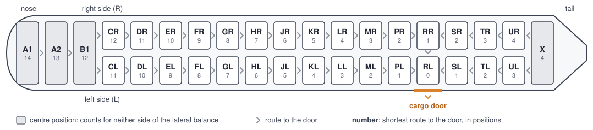
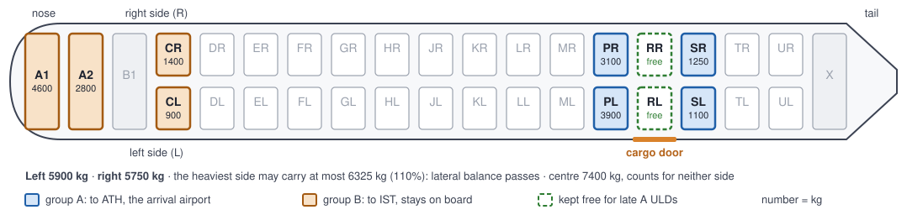

# Autoload: from booking data to a proposed load

*Design proposal for a future extension, by Romeo Weyns. Not implemented. Companion proposal: [knock-on delay prediction](knock-on-delay.md) by Jonas Friedhoff.*

## Problem

Today a load planner gives every booked ULD a load position by hand on the 34 positions of the Boeing 747-400F, runs the load checks and shuffles ULDs around until the hard checks pass. That has to happen within the loading period, which closes at ETD − 20 min. ULDs booked late upset an almost finished load: if the positions near the door are already full, a ULD has to move, and it may already be in the aircraft.

**Autoload** proposes a complete load: the planner reviews, adjusts and finalizes. Finalizing stays a human decision, because that responsibility belongs to the load planner. The proposal rests on two things: **rules** about what is booked now, and a **prediction** of what will still be booked. The requirements list autoload as a later extension.

## What the proposal must respect

*The main deck of the Boeing 747-400F, seen from above with the nose on the left. The number in each position is the length of its shortest route to the door (step 3).*

- **Floor plan:** A1, A2, B1 in the nose, rows C to U each with an L and an R position, X in the tail. The cargo door is on the left at RL.
- **Routes to the door are not symmetric.** A ULD on the left follows the left side to RL. A ULD on the right follows the right side to RR and then crosses over to RL. From A1, A2 and B1, CL and CR must both be free, and the nose is emptied from back to front: for A1, A2 and B1 must also be free, for A2 also B1. From X, UL and UR must both be free.
- **Offloading (hard):** every ULD for the arrival airport must be offloadable without moving a ULD with another destination. ULDs for the arrival airport may be offloaded first. A ULD with another destination stays on board and is only an obstacle.
- **Lateral balance (hard):** the heaviest side carries at most 110 % of the lightest. A1, A2, B1 and X count for neither side. Weight on one side against an empty side always fails the check, because the lightest side then carries 0 kg.
- **Not all cargo loaded (soft):** every booked ULD has a position. More than 34 ULDs never fit; then cargo stays behind, but the hard checks can still pass.
- **Planning and loading run together.** The loading period is the window in which the load may still change; ETD − 20 min is the final limit, not the start of loading. In practice ground handling already loads the aircraft during the period, according to the load as planned at that moment. The requirements and our model make no distinction between a planned and a physically loaded ULD: a load position is both. A ULD that already has a position may therefore already be on board, and moving it means taking it back out of the aircraft. **A proposal therefore moves as little as possible, now and later.**

## From rules to a proposal

**Input:** the booked ULDs (code, weight with unit, destination), the arrival airport, the floor plan (positions, side, routes, cargo door), the policy value `LateralBalanceLimit` (10 %) and, if available, the expected late cargo (see below).
**Output:** a load position for every ULD without a position, the positions kept free for late cargo, separately the ULDs the proposal moves (with the reason), the version of the load the proposal is based on, and the report of the load checks on the proposal.

| Step | What | Why |
|---|---|---|
| 1. Keep | ULDs that already have a load position stay; only ULDs without a position get one. Only if the hard checks cannot pass otherwise does autoload move ULDs: as few as possible, and first the B ULDs that block a route of group A | A placed ULD may already be on board; every move costs work on the apron and time in the loading period |
| 2. Group | Group A: the ULDs for the arrival airport. Group B: all others | Offloading only requires that group A can get out |
| 3. Distance | Every free position gets the length of its shortest route to the door (RL: 0, PL and SL: 1, RR: 1, PR and SR: 2, ...; see the numbers in the figure) | A position on the route of another position always has a shorter route |
| 4. Keep free | If the prediction still expects *k* late A ULDs, the *k* positions with the shortest route stay free, alternating left and right. For late B ULDs positions only stay free when space gets tight; usually enough remain on the far side. Positions are only kept free as long as all ULDs booked now get a position | A late A ULD belongs near the door. If everything there is already full, something has to move. A free position blocks no route |
| 5. Distribute | Heaviest ULD first, each time to the lightest side, counting the weight already on board (left on a tie). An A ULD gets the free position closest to the door there, a B ULD the one furthest from the door (on equal distance the one closest to the nose). If a B ULD on the lightest side would make the difference between left and right larger than it already is, it gets a free centre position, the nose first. If the balance can only pass with an A ULD in the centre (for example with a single ULD), that ULD gets X, and no B ULD may be on UL or UR | A near the door and B far away: then a B ULD is never on the route of an A ULD. A heavy ULD on the lightest side can make the difference larger than it was; in the centre it counts for neither side. X is at distance 4 and is the only centre position that makes sense for an A ULD |
| 6. Improve | Two ULDs **of the same group** in the same row swap sides, as long as the difference between left and right gets smaller. Only ULDs that get a position in this proposal | Every position keeps a ULD of the same group, so every route sees the same obstacles and offloading stays valid. Moving a single ULD to the empty opposite side is *not* safe: on the right the route goes over RR |
| 7. Check | The proposal through the same `List<LoadCheck>` as Check Load. The positions kept free count for nothing: the load must pass **now**, not only once the late cargo arrives | The rules live in one place; a new check also tests every proposal right away. A prediction may never approve a load that fails today |
| 8. Explain | The report, per ULD why it is in that zone and on that side, why positions stay free ("on 80 % of the HJ221 flights on Monday at most 2 ULDs for ATH were added after this hour"), and per move which check fails without that move | A proposal the planner doesn't understand won't be used |

### Example: HJ221 BRU→ATH

Eight ULDs are booked: four for ATH, the arrival airport (group A), and four for IST, which stay on board (group B). The prediction expects two more late A ULDs. Nothing is on a position yet, so step 1 keeps nothing.

**Step 4, keep free:** RL and RR, the shortest route on the left (0) and right (1), stay free for the two late A ULDs.

**Step 5, distribute, heaviest ULD first:**

| # | ULD | kg | To | Position | Why | Left / right (kg) |
|---:|---|---:|---|---|---|---:|
| 1 | PMC28813HJ | 4600 | IST | A1 | Both sides 0 kg; on one side the difference would become 4600 kg: centre, nose first | 0 / 0 |
| 2 | PMC31042HJ | 3900 | ATH | PL | Equal sides: left; the closest free position, because RL stays free | 3900 / 0 |
| 3 | PMC30577HJ | 3100 | ATH | PR | Right is lighter; RR stays free. PR and SR are equally far from the door; PR is closer to the nose | 3900 / 3100 |
| 4 | PAG11950HJ | 2800 | IST | A2 | Difference 800 kg; on the right it would become 2000 kg: centre | 3900 / 3100 |
| 5 | AKE15532HJ | 1400 | IST | CR | On the right the difference would become 600 kg, smaller than 800: right, as far from the door as possible | 3900 / 4500 |
| 6 | AKE16689HJ | 1250 | ATH | SL | Left is lighter; SL is the closest free position on the left | 5150 / 4500 |
| 7 | AKE17204HJ | 1100 | ATH | SR | Right is lighter; SR is the closest free position on the right | 5150 / 5600 |
| 8 | AKE18820HJ | 900 | IST | CL | On the left the difference stays 450 kg, not larger: left, as far from the door as possible | 6050 / 5600 |

**Step 6, improve:** SL and SR, two ATH ULDs in the same row, swap sides. The difference drops from 450 to 150 kg: 5900 kg left, 5750 kg right. In row P and row C a swap would make the difference larger.

**Step 7, the checks on the current load:**
- **Offloading:** the ATH ULDs on PL and SL go out via RL, those on PR and SR via RR and RL. No IST ULD is on those routes: passed.
- **Lateral balance:** 5900 kg left against 5750 kg right; the heaviest side may carry at most 110 % × 5750 = 6325 kg: passed. A1 and A2 (7400 kg together) don't count.
- **Not all cargo loaded:** every booked ULD has a position: passed.

**If the late cargo does arrive,** the planner asks for a new proposal. It keeps everything in place (step 1) and puts the late ULD on a position kept free, on the side that disturbs the balance least. In the example a late ATH ULD of 500 kg fits on RR (5900 / 6250 kg). A late ULD of 1200 kg breaks the balance on both sides (7100 / 5750 on RL, 5900 / 6950 on RR); it gets X, because UL and UR are free. The prediction thus prevents a move, but the checks decide.

**Why greedy.** The balance part is a variant of the partition problem and NP-hard in general, but only *weakly*: with at most 34 ULDs and weights in whole kg, dynamic programming or a constraint solver also finds the optimum. We choose greedy because it is simple, fast and explainable, and because the 10 % margin and the four centre positions almost always leave room. An exact strategy can be added next to it later (see architecture).

**If there is no valid load.** Autoload doesn't guess: it returns the best proposal with the report and the reason. That happens with so many A ULDs that they no longer all fit near the door, and with a distribution that stays outside the 10 % because the zones or the ULDs already in place limit the choice of side. If it only works by moving ULDs, that is listed separately in the proposal: the planner decides whether those handlings on the apron are worth it. **If there are more ULDs than free positions,** autoload keeps nothing free and places the ULDs in the order they were booked; the rest is listed separately and the soft check reports that they stay behind. Which cargo gets priority is a business decision (see open questions).

## From data to a prediction: late cargo

Step 4 needs one number: how many ULDs will still be booked for this flight after this moment, and for which group? That number comes from the bookings of previous weeks. First we sharpen the problem:

| Part | Late cargo |
|---|---|
| Problem | Late bookings force moves on the apron |
| Decision | Which positions stay free in the proposal (step 4) |
| One observation | One flight at one prediction moment |
| Prediction moment | 12, 6, 3 and 1 hour before the STD |
| Target | The number of late A and B ULDs after that moment; in the next step also their weight |
| Available information | Only what is known at that moment |
| Success | For the business: fewer moves on the apron. In evaluation: moves (primary) and empty positions kept free (secondary). When training a learned model: the quantile loss |
| Baseline | "Nothing more will come": keep nothing free |

- **Label.** The actual number, per flight and per fixed moment (12, 6, 3 and 1 hour before the STD). The system gets it for free: every booking comes in anyway (`UldBookingReceived`, with `occurredOn`), and once the flight has departed, what was added after each moment is fixed. Nobody has to label anything.
- **What the model knows.** Only what is known at moment *t*: flight number, weekday, arrival airport and the number of hours until the STD. A booking that came in after *t* must stay hidden; otherwise it learns from information it doesn't have yet when making a real prediction.
- **Model.** Per group (flight number, weekday, moment) the 80th percentile of the late A and B ULDs over the previous flights. If a group has fewer than 8 flights, it falls back to a wider group: the flight number over all weekdays, then the arrival airport, and finally the rule "nothing more will come". We take the 80th percentile and not the mean, because keeping too little free costs a move and keeping too much only a position that stays empty.
- **Why so simple.** It is about small numbers (0, 1, 2 ULDs) with four features. A percentile per group can be explained in one sentence (step 8), needs no library and can be checked with ordinary unit tests. A more complex model (for example gradient boosting) only makes sense with more features, such as seasons or the number of bookings already in at *t*, and must then beat this percentile (see "Next step").
- **Metric.** We replay the bookings of a week through autoload, once with and once without keeping positions free, and count:
  - **moves (primary):** how often a late ULD only finds a place by moving a ULD that was already placed. That is what ground handling notices;
  - **empty positions kept free (secondary):** how many positions were still empty at finalizing while they were kept free. Without this metric, the model that keeps everything free always wins;
  - **coverage (check):** for how many flights the late cargo fitted in the positions kept free; at the 80th percentile that should be around 80 %. Much more means keeping too much free, much less a model that is wrong.

  To compare two predictions we use the quantile loss (pinball loss). At the 80th percentile it penalizes a prediction that is too low four times as hard as one that is too high. That fits: a prediction too low costs a move, one too high only an empty position.
- **Train and test over time and per flight.** The percentiles come from all weeks before the last week; the test is on the last week, never on a random sample, because then the model would learn from the future it has to predict. The split is on the STD date, so the four records of one flight are always on the same side; otherwise the model recognizes a flight in the test it has already seen. The choices in the model, such as the percentile (70th, 80th or 90th) and the threshold of 8 flights, are also tuned within the training weeks: each time learning on the earlier weeks and validating on the week after. The test week stays untouched until the final comparison. A weekly job recalculates everything. A new version only goes live if it gives fewer moves than the rule, without many more empty positions kept free.
- **Clean data.** A booking doesn't depend on what autoload proposes: the cargo customer doesn't know which positions stay free. The model therefore doesn't learn from its own influence, unlike a model that learns from what planners do with a proposal.

**The 7-day rule.** A flight and its cargo disappear 7 days after the scheduled departure date. Insights therefore stores no flights, but a histogram per group and per moment: for how many flights were 0, 1, 2, ... late A and B ULDs added. A histogram is enough to calculate any percentile and contains no date, registration, ULD code or planner. Whether such a summary respects the rule is for the business to decide. Until then Insights keeps nothing longer than 7 days. Then each flight number has at most 7 flights, fewer than the threshold of 8, and autoload works with the rule: the prediction is ready, but has nothing to say yet.

## Next step: a learned model and planning against possible futures

The percentile is the first version and stays the baseline. Two extensions make the proposal smarter. Each only goes live if, when replaying the last week, it gives fewer moves than what is already running.

### 1. A learned model of the late cargo

- **What it learns in addition:**
  - **the booking pace:** how many ULDs are already booked at moment *t*, compared to what is usually booked at that moment for this flight number. A flight that lags behind often catches up; a flight that is already full gets little more. Airlines use the same idea to forecast passenger bookings. The percentile per group cannot use this feature. The model calculates what is "usual" from the training weeks only: if it includes the test week, that leaks into the features and the test looks better than reality;
  - **the weight:** not only how many late ULDs, but also how heavy. In the example a late ULD of 1200 kg breaks the balance on both sides and has to go to X. A model that expects a heavy late ULD then leaves X free;
  - **more features:** month and season, holidays, and how many A and B ULDs are already booked.
- **Model.** Gradient boosting with a quantile loss, as in the [knock-on proposal](knock-on-delay.md): per group (A and B) one model for the number and one for the weight, each for the 10th, 50th and 90th percentile. The simpler alternative is a count model (Poisson or negative binomial regression) for the number, which directly gives a complete distribution. Gradient boosting finds by itself which combinations of features matter; a count model is easier to explain. Which of the two goes live is decided by the test on the last week.
- **Explanation.** Gradient boosting can show per prediction which features pushed it up or down (the contribution per feature, SHAP). The planner then sees, for example: "2 late ULDs expected, mainly because only 3 of the usual 7 are booked".
- **Data.** One record per flight and per moment: the features at *t* and what was still added after it (number and weight per group). That is more than a histogram, because it belongs to one flight. It therefore clashes harder with the 7-day rule, just like the records of the knock-on prediction. Without flight number and date (only weekday and month) such a record is hard to trace back to one flight; whether that is enough is for the business to decide.
- **Cost.** A training pipeline, model versions and quality monitoring. XGBoost4J keeps Insights on Java, as in the knock-on proposal.

### 2. Planning against simulated futures

With one percentile, a fixed rule decides how many positions stay free. With a complete distribution, autoload can weigh that choice itself.

- **How.** From the expected distribution autoload draws, for example, 200 possible futures: so many late A and B ULDs with those weights. For every choice of positions to keep free (none; RL and RR; RL, RR and X; three positions at the door; ...) it plays out every future: first the proposal, then the late ULDs added with the same steps 1 to 7. It picks the candidate with the fewest moves on average, and on a tie the one with the fewest free positions. That is a Monte Carlo evaluation: estimating the value of a choice as the average over many simulated outcomes. There is only one choice to make, so no search tree as in games.
- **Average, not worst case.** Choosing on the worst case (minimax) assumes the future plays against us. Then autoload always keeps the maximum free, because in one of the 200 futures a lot of late cargo will come. The average weighs every future by its probability. If the business wants to be more cautious, autoload can choose on a high percentile of the moves, for example the 90th, instead of the average.
- **Calibrated.** The futures are only as good as the probabilities they are drawn from. If the model says "30 % chance of a late A ULD" for a set of flights, that should happen for about 30 % of those flights. We check that on the test week, per probability class, before the model goes live.
- **Value.** The prediction now drives a decision under uncertainty instead of a fixed rule. Autoload keeps X free when heavy late cargo is likely, and nothing when hardly anything is ever added. The explanation becomes concrete: "in 200 possible futures this proposal needed a ULD to move 12 times, without keeping positions free 40 times".
- **Computation.** 200 futures × a handful of candidates × a greedy run over at most 34 ULDs: a few milliseconds.
- **Reproducible.** The futures come from a random generator with a fixed seed, derived from the flight and the version of the load. Asking for the same proposal twice therefore gives the same answer, and the unit tests stay deterministic. The randomness comes in as a parameter, like the `Clock`.
- **Place.** A second strategy, `ScenarioAutoloadStrategy`, that reuses the greedy steps. `ExpectedLateCargo` then carries a distribution instead of one number: per group the probability of 0, 1, 2, 3 or more late ULDs and the percentiles of their weight.

### What that changes in the architecture

- In Insights a port `LateCargoModel` with two implementations: `PercentileLateCargoModel` (the histograms, in the domain, with ordinary unit tests) and `TrainedLateCargoModel` (in the infrastructure layer, loads the trained model). The same pattern as `DelayModel` in the knock-on proposal.
- `insights.late-cargo.expected` is calculated per flight and per moment instead of per flight number and weekday, because the booking pace differs per flight. The event gets a new version that carries the distribution.
- The weekly job trains, tests on the last week and only publishes a new model if it gives fewer moves than the percentile. That percentile always stays ready as a fallback.

## How good is autoload?

Whether autoload helps is measured by what the planner does with it. That is a metric, not a model: autoload doesn't learn from it, because the rules have no weights to adjust, and a model that learns from accepted proposals mostly learns from itself.

- **Untouched:** the share of ULDs that are still on the position from the proposal at finalizing.
- **Moves:** how often a ULD that already had a position was moved again.
- **Margin:** the time between finalizing and the end of the loading period, with and without autoload.

For that the entity `Uld` remembers whether its position came from a proposal and how often it was moved, and `LoadFinalized` carries that per ULD. "Untouched" stays a metric and not a goal: a planner who blindly accepts every proposal scores 100 % and checks nothing.

## Deliberately not chosen

- **Learning weights from planners' adjustments.** The greedy rules have no weights, and planning against futures also only weighs moves. Besides, what planners accept is influenced by the proposal itself.
- **Reinforcement learning.** An agent that learns by itself where to put ULDs learns what the rules already guarantee, needs millions of simulated flights and cannot be explained to a planner. Our simulator also only creates the cargo we put into it: good for testing, not for learning.
- **Deep learning.** Neural networks need a lot of data and mainly win on images, text and other unstructured data. Here it is about few, tabular records per flight, and the 7-day rule limits them even further. A tree model or a count model fits better and stays explainable.
- **Predicting whether the planner finalizes too late.** The only action is a warning. Besides, a flight without a finalized load cannot depart, and a loading period that has passed doesn't reopen: the failures are rare and leave almost no data.
- **An exact solver.** It can be added later as a second strategy next to greedy, without changing the rest.

## Place in the architecture

- **Load Planning (core)**, domain layer: a domain service `AutoloadStrategy` with `LoadProposal propose(FlightCargo, FloorPlan, LateralBalanceLimit, ExpectedLateCargo)`. A second strategy (for example a solver) is a second implementation, chosen through configuration, as the [analysis](../analysis.md) (§9) also describes for new load checks and floor plans.
- **`LoadProposal` is a value object:** the positions for the ULDs without a position, the positions kept free with their reason, separately the moves with their reason, the version of the load it is based on and the report. It doesn't change the aggregate: proposing is reading, and a proposal the planner rejects must leave no trace.
- **Checking a proposal.** `LoadCheck` works on a `FlightCargo`, not on a proposal. The aggregate therefore makes a copy with the proposed load, and the checks run on that copy. It is never stored. The checks thus stay unchanged; the alternative, checks that work on a list of `LoadedUld`, would touch every check.
- **Applying.** A new method on the root, `FlightCargo.applyProposal(proposal, planner, now, floorPlan, policy)`, checks everything at once: whether the loading period is running, whether the load is not yet finalized, whether every ULD is booked, whether the positions come from the floor plan and whether the load still has the same version as the proposal. If the load has changed in the meantime (another planner, a new booking), it refuses with "ask for a new proposal". It first takes the ULDs that move off their position and then puts every ULD on its new position. That way a ULD that moves from PL to ML doesn't collide halfway with another ULD going to PL. ULDs that stay in place are not touched. One aggregate, one transaction, the usual `LoadPositionAssigned` events and the optimistic lock as with two planners at the same time.
- **API and screen:** `GET /api/flight-cargos/{id}/load-proposal` (changes nothing) and `POST /api/flight-cargos/{id}/load-proposal` with the version of the proposal to apply it (200 with the load, 409 with the reason). On the floor plan of the cargo page the proposal is first shown as a preview, next to the current load, with the positions kept free marked.
- **A new version of `LoadFinalized`.** The event gets, per ULD, whether the position came from a proposal and how often the ULD was moved. That is a new version of the contract `load-planning.flight-cargo.load-finalized`, with an example in `contracts/` and a `ContractTest` on each side; the reader of Messaging must know that version before it receives it.
- **The Planning Insights unit.** It also contains the [knock-on prediction](knock-on-delay.md): analysis, not core.
  - **Input:** the queue `insights.messaging-events` on `messaging.events`, with `messaging.uld-booking.received` and `messaging.flight.#` (STD, ETD, departure and `messaging.flight.removed`). In addition a queue `insights.load-planning-events` on `load-planning.events` with `load-planning.flight-cargo.load-finalized`, directly, as Messaging already reads that event (open host service). The same rules as for the other units: one consumer per queue for the order, check the version, its own dead letter queue.
  - **Output:** the event `insights.late-cargo.expected` on `insights.events`, per flight number, weekday and moment the expected number of late A and B ULDs, with the model version. Load Planning keeps it as a local copy `ExpectedLateCargo`, like `FlightInfo` (ACL). The same line as in the knock-on proposal: data that feeds a decision travels as an event with a local copy; data that is only shown (the autoload metrics) is requested from Insights by a screen.
  - **Training:** a weekly job, like `FlightRetentionScheduler`, updates the histograms, tests on the last week and only publishes a new version if it beats the rule.
  - **Outage:** if Insights goes down, autoload works with the last copy, or with the rule if there is none. Between the units everything stays asynchronous.
- **Scaling.** The [analysis](../analysis.md) (§6) already names autoload as a reason to scale Load Planning separately. The computation of the prediction is not in the core domain, but in Insights, which scales separately.

## Risks and open questions

- **Trust:** a proposal without an explanation won't be used, and a proposal that is always accepted is no longer reviewed. The report and the explanation per ULD are therefore part of the proposal, and finalizing stays with the planner.
- **A prediction is not a guarantee:** the hard checks decide on every change and again at Finalize Load. A position kept free is simply a free position; the planner may always use it.
- **Drift:** a new flight schedule or a new customer makes old histograms worthless. The weekly test on the last week catches that: if the prediction does worse than the rule, the rule applies.
- **Extensions:** a new check tests every proposal right away, but steps 1 to 6 don't take it into account yet. A proposal can then fail on that check; autoload shows that, with the reason, until the strategy is adjusted.
- **Physical loading is not modelled:** the model doesn't know which ULD is really on board already. Autoload therefore assumes that every placed ULD may be on board, and only moves what is necessary.
- **Open for the business:**
  - whether a histogram per flight number respects the 7-day rule, and for the learned model a record per flight without flight number and date. Until then Insights keeps nothing longer than 7 days and autoload works with the rule;
  - which cargo gets priority when not everything fits. Until then autoload places in booking order.
