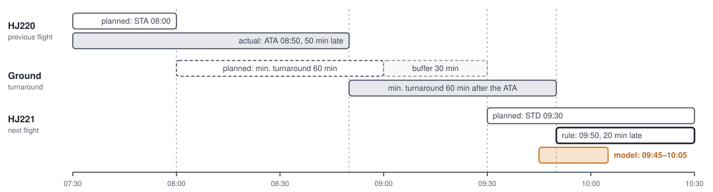
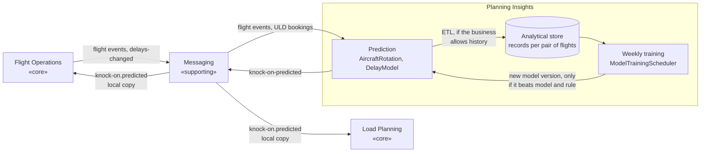

# Knock-on delay: from flight data to an expected departure

*Design proposal for a future extension, by Jonas Friedhoff. Not implemented. Companion proposal: [autoload](autoload.md) by Romeo Weyns.*

## Problem

A flight planner only sees a delay once someone enters it. If an aircraft lands 50 minutes late, its next flight with the same aircraft often departs late too, and maybe the one after that. The system records none of this: the ETD of that next flight stays equal to the STD until a flight planner enters a delay ([`EstimatedTimes`](../../flight-operations/flight-operations-service/src/main/java/be/kdg/airfreight/flightoperations/domain/flight/EstimatedTimes.java)), at the latest when the departure is registered, because an ATD may be at most five minutes after the ETD ([`ActualTimeTolerance`](../../flight-operations/flight-operations-service/src/main/java/be/kdg/airfreight/flightoperations/domain/flight/ActualTimeTolerance.java), [policy values](../policy-values.md)). Yet the requirements ask for "early enough insight into future delays to anticipate them". This is not an edge case: in Europe, reactionary (knock-on) delay was the largest cause of delay in 2024, with 46 % of all delay minutes across all flights in Europe ([EUROCONTROL CODA, All-Causes Delays Annual 2024](https://www.eurocontrol.int/publication/all-causes-delays-air-transport-europe-annual-2024)).

**Knock-on prediction** predicts, as soon as an aircraft is late, when the next flights of that same aircraft will depart, and shows it next to the ETD. The prediction is information, not a delay: entering a delay stays with the flight planner, because that decision and its consequences (delay reason, MVT-ED and MVT-EA, the end of the loading period) belong to them. The requirements name "geographic consistency" as a later extension: an aircraft can only depart from where it last landed. That is exactly the chain the prediction follows.

## What the prediction must respect

- **Delays stay manual.** A delay is a number of minutes (at least 1 min; all delays of a flight together at most 12 h), a delay reason as an IATA code and a description. The ETD is the STD plus all departure delays, and every change of the ETD sends an MVT-ED and an MVT-EA. A prediction that moved the ETD would therefore send telegrams based on an estimate. That is why the prediction never touches the flight.
- **The chain follows the aircraft registration.** Every flight has an [`AircraftRegistration`](../../flight-operations/flight-operations-service/src/main/java/be/kdg/airfreight/flightoperations/domain/flight/AircraftRegistration.java). The next flight of an aircraft is the flight with the same registration, from the airport where the previous one lands, with the first STD after the STA of that previous one. The system does not (yet) enforce geographic consistency. If two flights don't connect, for example because of an aircraft swap, the prediction stops there instead of guessing.
- **The system learns the minimum turnaround itself.** The requirements define no ground time, and having it entered per airport doesn't scale. Only an aircraft that lands late shows how fast a turnaround can be: it departs as soon as possible, while an aircraft on time simply waits for its STD. Per airport we therefore take from the history the ground time (ATD of the next flight − ATA of the previous one) that late aircraft regularly achieve, for example the 10th percentile. Without history a default per aircraft type applies, a [policy value](../policy-values.md); today that is only the 747-400F, but more aircraft types are a planned extension. The rule uses that minimum turnaround; the model does not need it.
- **What is already fixed wins.** As soon as the previous flight has landed, the prediction uses the ATA instead of the ETA. If a flight planner has already entered a delay, it is in the ETD. The prediction only appears when it is later than the ETD, just as the screens only show the ETD when it differs from the STD. Once the flight has departed, it disappears.
- **The loading period does not move.** It ends at ETD − 20 min, not at the predicted departure. The load planner gets a warning, not extra time.
- **Time.** Everything is calculated in UTC. The screens show Brussels time and say so, as everywhere in the system.

## From data to a prediction

**Input:** the flights (registration, airports, STD/STA, ETD/ETA, ATD/ATA, delays with their IATA code), per flight the number and weight of the booked ULDs (the bookings, through Messaging), the learned minimum turnaround per airport and the model (see below).
**Output:** for every next flight of the aircraft an expected departure as a range (for example 10:40–11:05), the reason and the time of the calculation. It appears on the flight details under the ETD, on the cargo page for the load planner, and as a marker in the flight overview as soon as the expected delay exceeds a threshold. That threshold is a policy value with 15 min as default, the limit EUROCONTROL uses for an on-time departure ([CODA, All-Causes Delays Annual 2024](https://www.eurocontrol.int/publication/all-causes-delays-air-transport-europe-annual-2024)). Partners get nothing: an MVT-ED announces an expected time, so a prediction as an MVT would look like a real delay.

*Example: HJ220 lands 50 minutes late. The 30-minute buffer absorbs part of it, so according to the rule HJ221 departs 20 minutes late. From the history, the model predicts a range of 09:45 to 10:05.*

| Step | What | Why |
|---|---|---|
| 1. Chain | Per registration the flights by STD, where every flight departs where the previous one lands | The delay travels with the aircraft, not with the flight number |
| 2. Incoming delay | ETA − STA of the previous flight, or ATA − STA once it has landed | The ETA already contains every entered delay; the earliest signal there is |
| 3. Rule | Earliest departure = ETA or ATA of the previous flight + minimum turnaround. The buffer (planned ground time − minimum turnaround) absorbs part of it: expected delay = incoming delay − buffer, never below 0 | Explainable, works without history and is the baseline the model has to beat |
| 4. Model | Predicts the delay directly from the history for this airport, this hour, this number of ULDs; the rule stays baseline and safety net | In reality a turnaround under pressure rarely takes exactly the minimum time |
| 5. Propagate | The expected departure plus the planned flight time (STA − STD) gives an expected arrival, the input for the next flight. Stops as soon as the expected delay is 0 or the chain breaks | Every buffer absorbs part of it, so the delay fades out; the range gets wider with every step |
| 6. Update | Recalculate on every entered, changed or removed delay, every ATD and ATA and every new booking | The prediction follows the same events as the ETD |
| 7. Explain | Which previous flight, how late, how much buffer, and what the rule and the model each say | A prediction the planner doesn't understand won't be used (as with [autoload](autoload.md)) |

## How the model learns

Step 4 is the core. The rule only knows the minimum turnaround. The model learns from the history how a turnaround under pressure actually goes, and that differs per airport, hour and amount of cargo.

- **Training data.** One record per pair of consecutive flights of the same aircraft: the flight that comes in and the flight that departs next. A fleet of 30 aircraft with three rotations a day yields over 30,000 pairs a year.
- **Label.** The departure delay of the next flight, ATD − STD. The system gets it for free, because the flight planner registers the ATD anyway. Nobody has to label anything.
- **Features.** How late the previous flight is, the planned ground time, the airport, the hour and weekday of the STD, the month, and the number and weight of the booked ULDs. They are stored as they were at the departure of the previous flight: at that point the incoming delay is still an ETA, not an ATA. Otherwise the model learns from information it doesn't have yet when making a real prediction. External data such as weather and ATC slots can be added later.
- **Model.** Gradient boosting on tabular data: many small decision trees, where every new tree reduces the error of the trees before it. It handles a mix of numbers (minutes, kg) and categories (airport), needs no scaling of the numbers, and shows which features weigh most, which feeds the explanation in step 7. Two extra models predict the 10th and 90th percentile instead of the mean; together they give the range.
- **Metric.** The model must beat the rule on the mean error in minutes, measured separately for 1, 2 and 3 flights ahead, because further ahead is harder. On top of that, how often the actual departure falls within the range. For the 10th and 90th percentile that should be 80 %: much more often means a range too wide to be useful, much less a model that is too sure of itself.
- **Check with code 93.** A flight planner enters a knock-on delay with IATA code 93, "aircraft rotation, late arrival of aircraft from another flight or previous sector" ([IATA delay codes](https://ansperformance.eu/definition/iata-delay-codes/)). The label ATD − STD also contains other causes, such as late cargo. The minutes under code 93 show separately how well the model predicts the knock-on part.

**Without history** (a new airport, the first week) the prediction only works with the rule and the default per aircraft type. **The 7-day rule** deletes a flight and all its data 7 days after the scheduled departure date. [Autoload](autoload.md) therefore only keeps summaries per flight number and weekday. A model, however, learns from individual examples, so here one record per pair of flights is needed. That record contains no flight number, registration, date, ULD codes or delay description (free text can contain names), so it is hard to trace back to one flight. Hard, not impossible: at a small airport with one flight an hour it remains traceable. Whether such a record respects the rule is a question for the business. **Risk of the model:** if planners react to a warning with a faster turnaround, the model learns from outcomes it influenced itself and underestimates the knock-on delay. That is why the rule keeps running as a comparison.

## Place in the architecture

*Solid arrows between the units: events over RabbitMQ; inside Insights: its own store and the training. Every page reads the prediction from the API of its own unit.*

- **A module in Planning Insights.** Knock-on prediction goes into the same unit "Planning Insights" that the [autoload proposal](autoload.md) introduces: analysis, not core. It never changes a `Flight` or a `FlightCargo`. If Insights goes down, the system keeps working and the screens show the last prediction with the time of the calculation.
- **Input through Messaging.** Insights reads its own queue `insights.messaging-events` on `messaging.events`, with `messaging.uld-booking.received` and the flight events Flight Operations publishes (`announced`, `departure-` and `arrival-estimate-changed`, `departed`, `landed`, `removed`, `delays-changed`): the bookings only exist there, and Messaging already sends the flight events there. Not `messaging.flight.scheduled`: that is the SSM before Flight Operations checks it, and for an existing flight Flight Operations keeps the old registration. The same rules as for Load Planning: one queue and one consumer for the order, check the version, `insights.dlq` ([messaging](../messaging.md)).
- **A new event for delays.** Today the flight events only carry the new ETD or ETA ([contract](../../contracts/flight-operations.flight.departure-estimate-changed.json)), not the delays. For the code-93 check there will be `flight-operations.flight.delays-changed`, forwarded by Messaging as `messaging.flight.delays-changed`, with the complete list of delays of the flight: kind (departure or arrival), minutes and IATA code, without description. Because it carries the whole list, it sets a value, and a duplicate changes nothing, as with the other flight events. The example goes into `contracts/` with a `ContractTest` on each side.
- **The domain of Insights.** An aggregate `AircraftRotation` per `AircraftRegistration`: the flights of one aircraft by STD, with their times and the number and weight of the ULDs. It builds the chain and notices where it breaks. `messaging.flight.removed` takes a flight out, so Insights also keeps nothing operational longer than 7 days. The aircraft type for the default minimum turnaround comes from one setting today, just as Load Planning uses one `AircraftType` for every flight, until there is a mapping from registration to type. A domain service `KnockOnPropagation` propagates the chain (step 5) and asks the port `DelayModel` for a prediction per pair of flights with `PredictedDelay predict(TurnaroundFeatures)`. There are two implementations: `RuleDelayModel` in the domain (step 3, plain Java and therefore testable with ordinary unit tests) and `TrainedDelayModel` in infrastructure, which loads the trained model. As with autoload, a second strategy is a second implementation.
- **Publishing through Messaging.** After every recalculation Insights publishes, through an outbox, `insights.rotation.knock-on-predicted` on `insights.events`, one per flight whose prediction changes. The event carries the identity of the flight (flight number, scheduled departure date, departure airport), not an internal id, because Load Planning only knows that identity ([analysis](../analysis.md) §6). Furthermore the range, the reason, the model version and the time of the calculation, or "no prediction" when it no longer applies: the flight has departed, the chain breaks, or the expected departure is no longer after the ETD. Because every event carries the complete prediction, it sets a value and a duplicate changes nothing. Messaging forwards it as `messaging.knock-on.predicted`, deliberately not as `messaging.flight.*`, because it is not an event of Flight Operations. Partners get nothing: there is no MVT for it.
- **A local copy, separate from the aggregates.** Flight Operations and Load Planning read `messaging.knock-on.predicted` and store the prediction in their own table, not in `Flight` or `FlightCargo`. No rule of those aggregates uses it, unlike `FlightInfo`, which the loading period does need; in the aggregate every new prediction would touch its version and optimistic lock. That way every page only calls the API of its own unit ([analysis](../analysis.md) §6): `GET /api/flights/{id}` and `GET /api/flights` get a field `predictedDeparture`, the list also a flag `atRisk` above `flight-operations.policy.knock-on-threshold` (15 min), and `GET /api/flight-cargos/{id}` the same field `predictedDeparture`. `LoadingPeriod` ignores that copy, and on `FlightRemoved` it disappears too.
- **Screens.** The flight details show the expected departure under the ETD, in a different style and labelled "predicted"; the flight overview marks flights with `atRisk`; the cargo page shows it as a warning. The Gantt chart ([`ganttChartPresenter.ts`](../../flight-operations/flight-operations-frontend/src/ts/presenter/ganttChartPresenter.ts)) has one row per flight today, with a bar from STD to STA. The prediction adds a striped bar, which fits the planned extension "show delays visually". A row per aircraft would show the rotation directly, but is a bigger change.
- **History: ETL to its own store.** As soon as the next flight departs, Insights writes the record of the pair (see "How the model learns") to an analytical store, separate from the operational database. As long as the business has not decided, nothing stays there longer than 7 days either (see "Risks and open questions"). The data is therefore first stripped of what is traceable and only then stored (ETL). If the business allows full history, it can be done the other way round (ELT): store the raw events first and transform them later, so a new feature can also be calculated over old data. That costs more storage, but with 30 aircraft it stays under 1 GB a year.
- **Training.** A `ModelTrainingScheduler` in `infrastructure/messaging` with `@Scheduled(cron = "${insights.policy.training-cron}")`, once a week by default, like [`FlightRetentionScheduler`](../../flight-operations/flight-operations-service/src/main/java/be/kdg/airfreight/flightoperations/infrastructure/messaging/FlightRetentionScheduler.java), but with the cron as a policy value instead of fixed in the code. It trains on everything before the last week and tests on that last week, not on a random sample, because then the model learns from the future it has to predict. A new version only goes live if it beats both the current model and the rule; after that Insights recalculates the open rotations and publishes the predictions that change. The same job recalculates the minimum turnaround per airport. The training uses the JVM version of XGBoost (XGBoost4J), so Insights stays with Java and Spring.
- **Scaling.** An event touches one rotation, so a recalculation covers a few flights. Because Insights calculates ahead, a screen never waits for a calculation. The heavy work, the training, is not in a core context but in Insights, which scales separately.

## Risks and open questions

- **A prediction is not a delay.** An expected departure that looks like an ETD will be taken for one. That is why it has a different style, is shown as a range and is labelled "predicted". If a flight planner blindly copies the predicted minutes as a delay with code 93, the code-93 check measures the model against itself. The ATD stays an independent measure, because the aircraft really departs when it departs.
- **Aircraft swaps are invisible.** The registration of a flight comes from the SSM, and an existing flight is not created again. If in reality another aircraft flies, the system doesn't know and the prediction follows the wrong chain. That is only solved once the registration of a flight can change, for example with the planned extension "telegrams from partners".
- **Crew is outside the model.** A crew at its maximum duty time also passes delay on. Crew management is out of scope, so the model doesn't see it.
- **Noise in the input.** An ETA that is updated late makes the features at the departure of the previous flight too optimistic, and a wrong delay reason pollutes the code-93 check.
- **Drift.** A new seasonal schedule or a new ground handler makes old patterns worthless. The weekly test on the last week catches that: if the model gets worse than the rule, the rule stays or goes live.
- **Open:** whether a record per pair of flights respects the 7-day rule is for the business to decide. Until then Insights keeps nothing longer than 7 days, the prediction works with the rule and only learns the minimum turnaround from the last week. The same answer decides whether the history can move from ETL to ELT.
